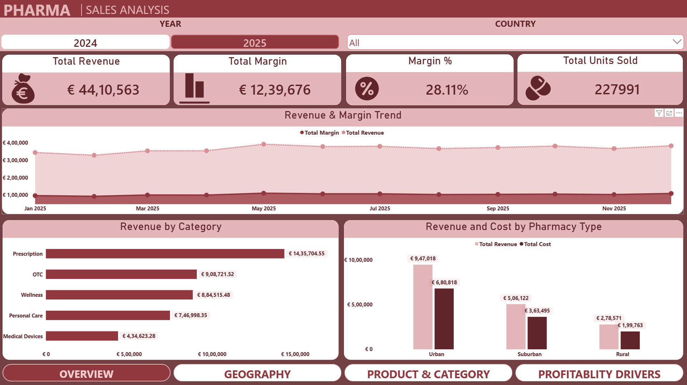
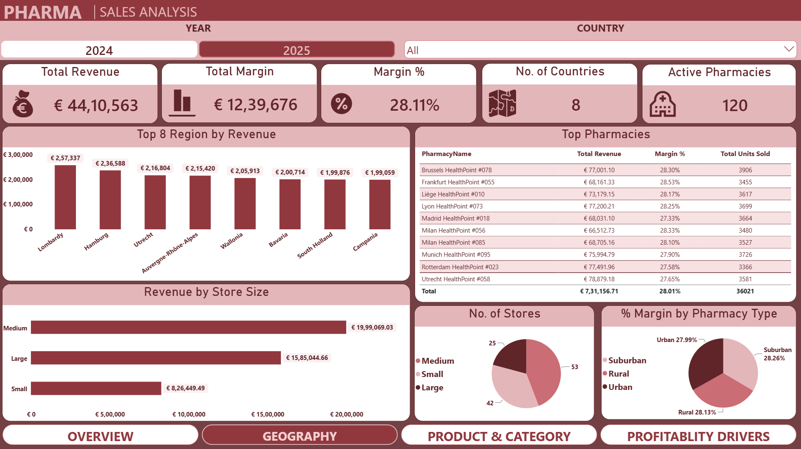
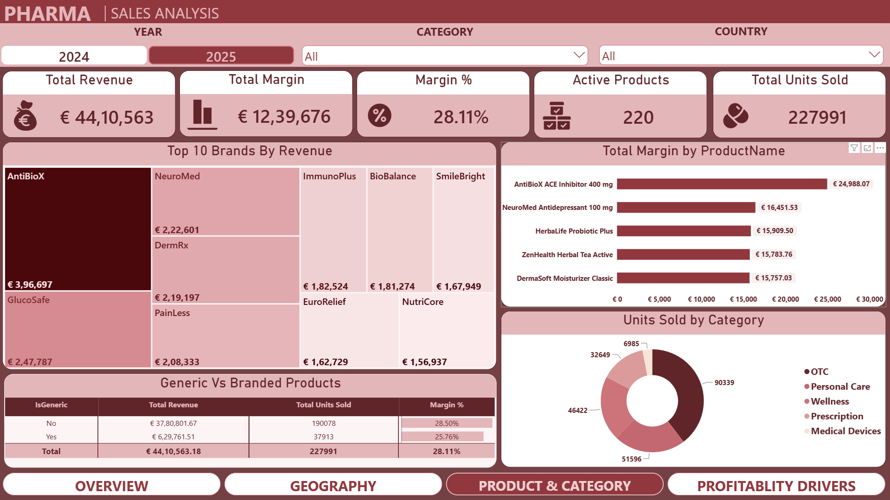
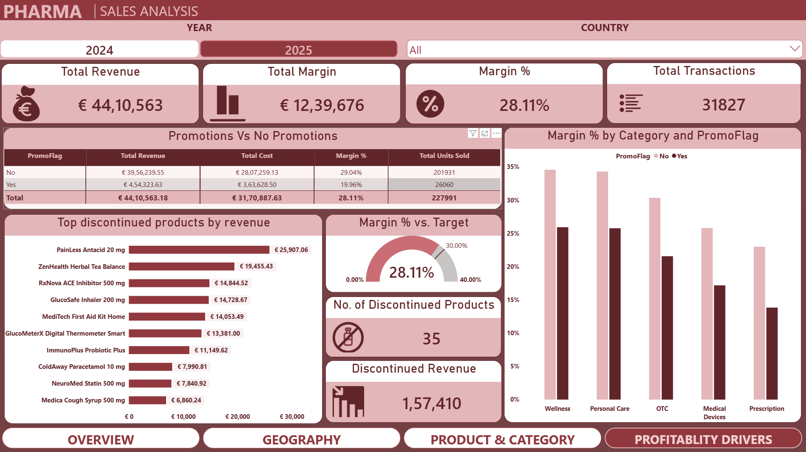

# 💊 Pharmacy Sales & Profitability Dashboard (Power BI)

An interactive 4-page Power BI dashboard that analyzes sales and profit for a European pharmacy chain: **where** the money comes from, **what** sells, and **what drives margin**.

🔗 **LinkedIn post:** https://lnkd.in/p/dGAJ72Q2

---

## 📸 Dashboard Preview

### Overview


### Geography


### Product & Category


### Profitability Drivers


---

## ❓ Business Questions Answered

- How much revenue and margin does the chain make, and is it growing?
- Which countries, regions and pharmacies perform best?
- Which product categories and brands bring the most revenue and profit?
- Do promotions actually help profitability?
- Does store type or store size change margin?

---

## 🔍 Key Insights (2025 view)

- 💶 **€4.41M revenue** and **€1.24M margin** (**28.11%**) from **227,991 units** across **31,827 transactions**
- 🌍 **Lombardy, Hamburg and Utrecht** are the top 3 regions by revenue
- 💊 **Prescription** brings the most revenue (€1.44M) but has the **lowest margin** among categories, while **Wellness and Personal Care** earn the highest
- 🏷️ **Promotions cut margin**: promo sales earn **19.96%** vs **29.04%** without promos
- 🧬 **Branded** products earn **28.50%** margin vs **25.76%** for generics
- 🏪 Margin stays near 28% across Urban, Suburban and Rural stores, suggesting store type has little effect on profitability
- 🚫 **35 products** are discontinued; 16 of them sold in 2025 (**€157K** revenue), all before their discontinuation dates
- 📈 Revenue grew about **4.4%** from €4.22M (2024) to €4.41M (2025)

> Use the **Year** slicer to switch between 2024 and 2025. Numbers above are for 2025.

---

## 🛠️ Tools & Skills Used

- **Power BI Desktop**: dashboard design, slicers, custom navigation
- **DAX**: measures such as Total Revenue, Total Margin, Margin %, ranking (RANKX)
- **Data Modeling**: star schema (1 fact table + 3 dimension tables)
- **Excel**: source dataset

---

## 🗂️ Data Model

| Table | Type | Rows |
|---|---|---|
| FactSales | Fact | 62,139 |
| DimDate | Dimension | 731 |
| DimPharmacy | Dimension | 120 |
| DimProduct | Dimension | 220 |

---

## 📁 Repo Contents

```
├── README.md
├── Pharmacy Dashboard.pbix
├── Pharmacy_Sales_Dataset.xlsx
└── Screenshots/
```

## ▶️ How to Open

1. Download `Pharmacy Dashboard.pbix`
2. Open it in **Power BI Desktop** (free)

---

## 👤 Author

**Darshan Vaghela** | Aspiring Data Analyst
🔗 [LinkedIn](https://www.linkedin.com/in/darshanvaghela9/) | 💻 [GitHub](https://github.com/DarshanVaghela97)
